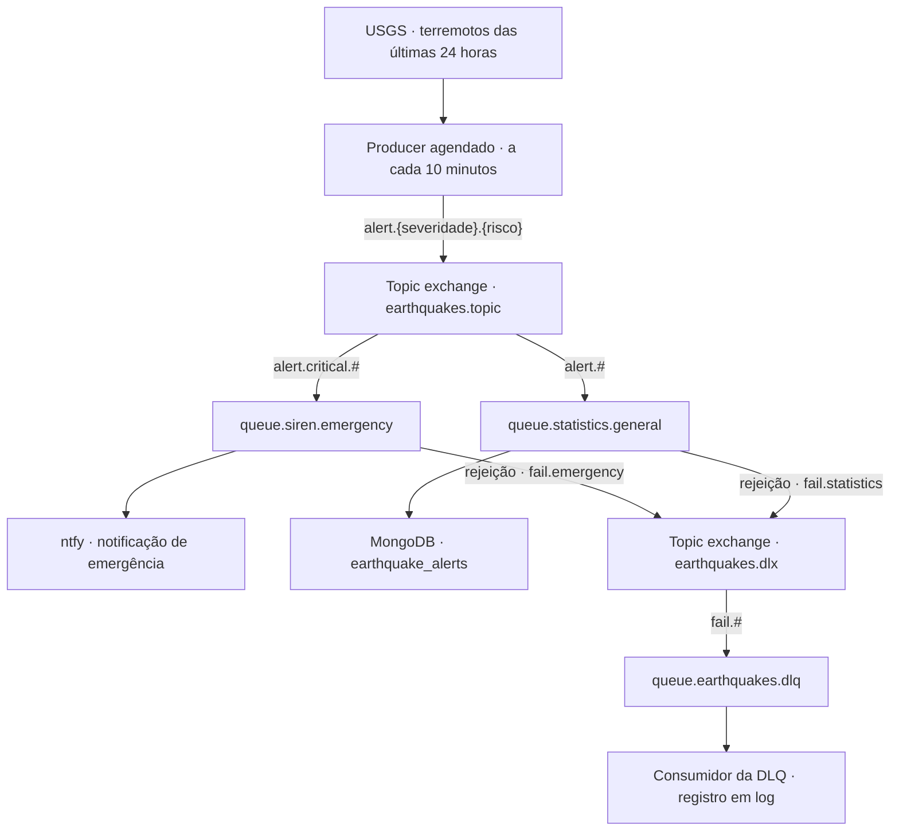

# Dominando Mensageria AMQP com Spring Boot e RabbitMQ

**Earthquake Watcher** — projeto de demonstração para uma apresentação de chapter técnico.

A aplicação utiliza dados reais de terremotos do [USGS](https://earthquake.usgs.gov/) para demonstrar publicação, roteamento e consumo de mensagens com Spring AMQP e RabbitMQ. Um mesmo evento pode alimentar dois fluxos independentes: envio de notificações de emergência e armazenamento no MongoDB para futuras estatísticas.

> Este é um exemplo didático, não um sistema de alerta de desastres. Não utilize suas notificações para decisões de segurança.

## O que a demo explora

- Publicação de eventos com `RabbitTemplate` e serialização JSON.
- Topic exchanges e roteamento por padrões de routing key.
- Consumidores independentes com `@RabbitListener`.
- Controle de mensagens em trânsito com prefetch.
- Rejeição sem requeue, dead-letter exchange (DLX) e dead-letter queue (DLQ).
- Persistência por ID do evento para evitar duplicação de documentos.

## Arquitetura



### Classificação e roteamento

A severidade é calculada pela aplicação a partir da magnitude; não corresponde ao campo de alerta oficial do USGS.

| Magnitude | Severidade | Exemplo de routing key |
|---|---|---|
| Menor que 2,5 | `low` | `alert.low.no_tsunami` |
| De 2,5 até abaixo de 4,5 | `medium` | `alert.medium.no_tsunami` |
| A partir de 4,5 | `critical` | `alert.critical.tsunami` |

O último segmento é `tsunami` ou `no_tsunami`, conforme o indicador recebido do USGS. As filas usam `#` para aceitar os segmentos restantes: todos os eventos vão para estatísticas, enquanto somente os críticos também vão para emergência.

### Topologia RabbitMQ

| Exchange | Fila | Binding |
|---|---|---|
| `earthquakes.topic` | `queue.siren.emergency` | `alert.critical.#` |
| `earthquakes.topic` | `queue.statistics.general` | `alert.#` |
| `earthquakes.dlx` | `queue.earthquakes.dlq` | `fail.#` |

Exchanges e filas são duráveis. A fila de emergência utiliza uma container factory com **prefetch 1**: cada consumidor recebe no máximo uma mensagem ainda não confirmada por vez.

Quando o processamento de uma fila principal lança uma exceção, o consumidor lança `AmqpRejectAndDontRequeueException`. A mensagem é rejeitada sem retornar à fila original e segue para a DLX usando `fail.emergency` ou `fail.statistics`.

**A DLQ possui um consumidor ativo que apenas registra o evento em log.** Por isso, ela pode aparecer vazia no painel mesmo após uma falha; não há reprocessamento automático nem retenção após esse consumo.

## Tecnologias

| Tecnologia | Uso |
|---|---|
| Java 25 e Spring Boot 4.1.2 | Aplicação |
| Spring AMQP e RabbitMQ 4 | Mensageria |
| Spring Data MongoDB e MongoDB | Persistência dos alertas |
| Spring WebFlux / `WebClient` | Integração HTTP com USGS e ntfy |
| Spring Scheduling | Coleta periódica |
| Docker Compose | Infraestrutura local |

As imagens utilizadas estão declaradas em `compose.yaml`.

## Executando localmente

### Pré-requisitos

- JDK **25**, com `JAVA_HOME` configurado.
- Docker Desktop ou Docker Engine com Docker Compose.
- Acesso à internet para consultar o USGS, enviar notificações e baixar dependências.

O projeto inclui Maven Wrapper; não é necessário instalar Maven separadamente.

### 1. Inicie MongoDB e RabbitMQ

Na raiz do projeto:

```powershell
docker compose up -d --wait
```

O Compose inicia somente as dependências. A aplicação Java é executada na máquina host.

| Serviço | Endereço | Acesso local |
|---|---|---|
| MongoDB | `localhost:27017` | Banco `earthquakewatcher`, sem autenticação |
| RabbitMQ AMQP | `localhost:5672` | Usuário `guest`, senha `guest` |
| RabbitMQ Management | http://localhost:15672 | Usuário `guest`, senha `guest` |

### 2. Configure um tópico de notificações

Em PowerShell, escolha um nome próprio para evitar compartilhar o tópico padrão:

```powershell
$env:NTFY_TOPIC = "earthquakewatcher-seu-topico-unico"
```

Abra `https://ntfy.sh/earthquakewatcher-seu-topico-unico` no navegador ou assine esse tópico no aplicativo ntfy. Use o mesmo nome definido na variável.

> O ntfy utilizado é um serviço externo público. Um nome de tópico difícil de adivinhar não substitui autenticação; não envie dados sensíveis.

### 3. Inicie a aplicação

No mesmo terminal:

```powershell
.\mvnw.cmd spring-boot:run
```

A coleta acontece a cada 10 minutos, nos minutos `00`, `10`, `20`, `30`, `40` e `50`; não é executada imediatamente na inicialização. Para demonstrar sem esperar pelo agendamento, publique um evento pelo painel conforme o roteiro abaixo.

### Configurações de conexão

Os valores de `application.yaml` podem ser sobrescritos por variáveis de ambiente:

| Variável | Padrão |
|---|---|
| `MONGODB_URI` | `mongodb://localhost:27017/earthquakewatcher` |
| `RABBITMQ_HOST` | `localhost` |
| `RABBITMQ_PORT` | `5672` |
| `RABBITMQ_USERNAME` | `guest` |
| `RABBITMQ_PASSWORD` | `guest` |
| `NTFY_TOPIC` | Tópico de demonstração definido em `application.yaml` |

Os endpoints HTTP são configurados em `usgs.api.base-url` e `ntfy.api.base-url`. Os nomes de exchanges, filas e bindings estão centralizados em `RabbitMQConfiguration`.

## Roteiro para a apresentação

### 1. Observe a topologia

Com a aplicação em execução, abra http://localhost:15672. Em **Exchanges** e **Queues and Streams**, localize os recursos da tabela de topologia e observe seus bindings.

### 2. Publique um evento crítico

Em **Exchanges**, abra `earthquakes.topic` e utilize **Publish message**:

- **Routing key:** `alert.critical.no_tsunami`
- **Properties:** `content_type` = `application/json`
- **Payload:**

```json
{
  "id": "demo-chapter-001",
  "magnitude": 5.2,
  "place": "Local ficticio para demonstracao",
  "timestamp": 1792846800000,
  "alertLevel": "critical",
  "hasTsunamiWarning": false
}
```

O evento será roteado para as duas filas principais: o consumidor de estatísticas grava o documento, e o consumidor de emergência dispara a chamada ao ntfy.

O RabbitMQ roteia pela **routing key**, não pelo conteúdo JSON. Ao publicar manualmente, mantenha os dois coerentes.

### 3. Compare com um evento de baixa severidade

Publique novamente com routing key `alert.low.no_tsunami`, outro `id`, magnitude `1.8` e `alertLevel` igual a `low`.

Somente a fila de estatísticas recebe esse evento. Isso demonstra como um topic exchange permite distribuir mensagens sem acoplar o produtor aos consumidores.

### 4. Consulte os dados e uma estatística

Liste os últimos eventos pela data de ocorrência:

```powershell
docker compose exec mongodb mongosh earthquakewatcher --quiet --eval 'db.earthquake_alerts.find().sort({occurredAt: -1}).limit(5).toArray()'
```

Agrupe os registros por nível de alerta:

```powershell
docker compose exec mongodb mongosh earthquakewatcher --quiet --eval 'db.earthquake_alerts.aggregate([{ $group: { _id: "$alertLevel", total: { $sum: 1 }, averageMagnitude: { $avg: "$magnitude" } } }, { $sort: { total: -1 } }]).toArray()'
```

O documento armazena o ID de origem como `_id`, magnitude, local, data de ocorrência (`occurredAt`), nível de alerta e indicador de tsunami. Salvar novamente o mesmo ID atualiza o documento em vez de criar outro.

A aplicação fornece a persistência para análises; não implementa API ou dashboard de estatísticas.

### 5. Demonstre o caminho de falha

Publique um JSON válido no mesmo exchange, com routing key `alert.low.no_tsunami`, mas altere o `id` para uma string vazia (`""`).

A validação do consumidor de estatísticas falha. A mensagem é rejeitada sem requeue, passa por `earthquakes.dlx` com routing key `fail.statistics` e chega a `queue.earthquakes.dlq`.

Observe no console o log do consumidor da DLQ. Como ele consome as mensagens automaticamente, o total de mensagens prontas na fila pode voltar a zero rapidamente.

## Limitações intencionais da demo

- A coleta consulta os terremotos das últimas 24 horas a cada execução, podendo republicar eventos já processados. O MongoDB evita documentos duplicados pelo ID, mas as notificações podem se repetir.
- O envio ao ntfy usa `subscribe()` de forma assíncrona. Uma falha HTTP posterior não é propagada ao listener e, portanto, não aciona automaticamente a DLQ de emergência. O processamento AMQP não garante a entrega da notificação.
- Não há política explícita de retry, publisher confirms, outbox ou fluxo de replay da DLQ.
- Filas duráveis e volumes persistentes não equivalem, isoladamente, a uma garantia ponta a ponta de entrega ou processamento exatamente uma vez.
- O Compose é exclusivo para desenvolvimento: portas restritas ao localhost, MongoDB sem autenticação e RabbitMQ com credenciais padrão.

## Encerrando a demonstração

Interrompa a aplicação com `Ctrl+C` e pare os serviços:

```powershell
docker compose down
```

Os dados permanecem nos volumes nomeados para a próxima execução.

## Referências

- [Spring AMQP](https://spring.io/projects/spring-amqp)
- [RabbitMQ — Exchanges](https://www.rabbitmq.com/docs/exchanges)
- [RabbitMQ — Dead Letter Exchanges](https://www.rabbitmq.com/docs/dlx)
- [USGS — GeoJSON Summary Feed](https://earthquake.usgs.gov/earthquakes/feed/v1.0/geojson.php)
- [ntfy](https://docs.ntfy.sh/)
